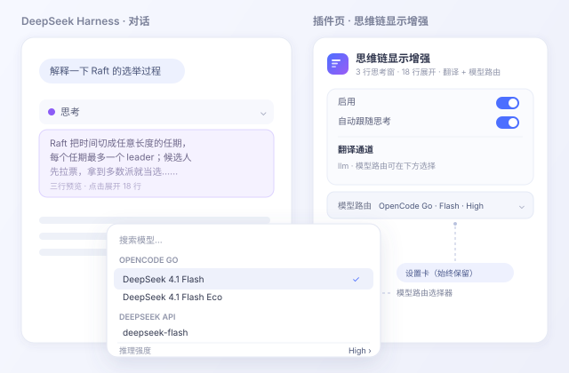

# Reasoning display enhancement

The plugin does two things: **the reasoning box** and **reasoning translation**. The answer body gets no plugin effects and is rendered directly by Harness Markdown components; the built-in `assistant-step` row is swapped only to host the reasoning box.

## Reasoning box

Reasoning appears in an inline box beside the Think row: a three-line preview, click for the full body (up to 18 lines, shrinking for short content), click again to collapse. When thinking ends it settles back to the first line and collapses; one flourish per stream, never replayed for restored history. Reveal uses one fixed `balanced` cadence and the logarithmic fade stays on; both are skipped under OS reduced motion.

## Translation and model route

The Think row toggles between “Show translation” and “Show original”. Two backends:

- **Official bundle**: enable the reasoning-translation bundle on the Plugins page and it chooses the service;
- **Model route (llm)**: the translation channel offers the same picker as the composer model menu — a one-line summary (provider · model · reasoning effort), a provider-grouped model list with search, and a reasoning-effort list. Choices are staged only; the channel's Save writes them.

While streaming, only finished fragments are translated and the tail stays original; historical reasoning blocks are always manual.

## Settings card

The Plugins-page **settings card always stays in place**: the page is the plugin header/detail plus that card. It has three parts: **enable**, **auto-follow reasoning**, and the **translation channel** (backend, model route, target language, fragment limit, auto-translate; `maxTokens` / `timeoutMs` live in the `translation.json` seed only). `enabled` / `thinkAutoExpand` persist in the profile `cordis.patch.yml` entry and apply live; translation settings persist in `~/.dsh/think-box/translation.json`.

Enabling translation sends reasoning text to the selected service or model route. `autoTranslate` controls automatic sending; historical blocks stay manual.

## Compatibility and limits

Tested on DSH `0.2.2-rc.5`; requires `>=0.2.2-rc.5 <0.3.0`. The plugin depends on non-public seams (in-place `assistant-step` swap, `groupPart` split, `turnProcess` fold, connection RPC, volatile config + `configEditor`); re-regress after DSH upgrades. Translation covers the reasoning box only.

The full suite is **155/155** green with no skips.
